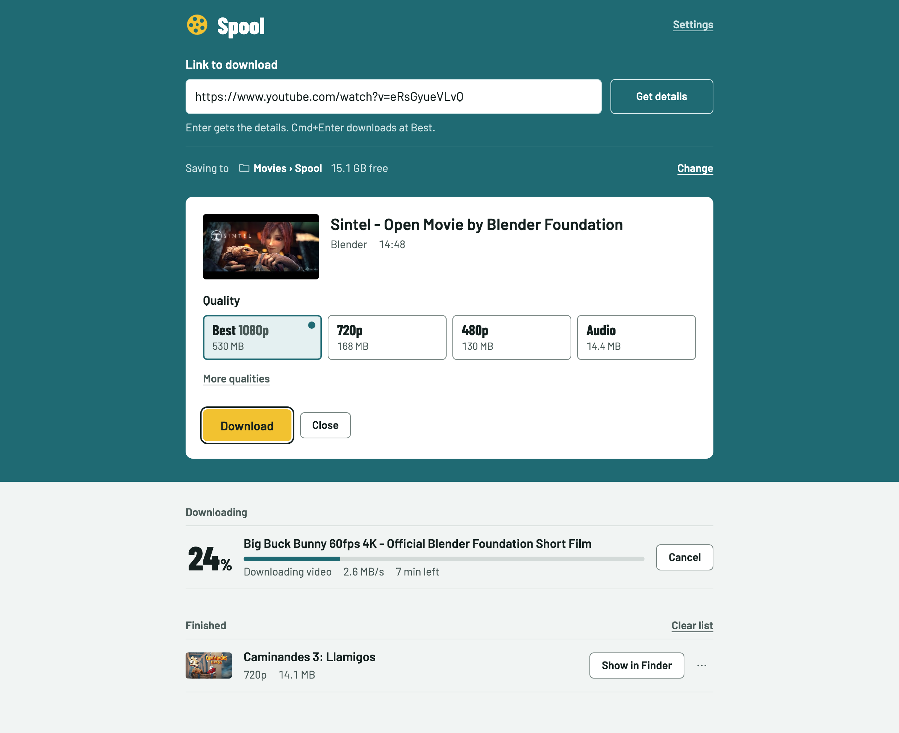

# Spool

Save any video to your own disk. Paste a link, pick a quality, get the file.

<picture>
  <source media="(prefers-color-scheme: dark)" srcset="docs/spool-dark.png">
  
</picture>

Spool runs on your computer and opens in your browser. No account, no ads, nothing uploaded. Free and open source.

## What you get

- **The quality you choose.** Every quality the site offers, up to 4K, with the file size shown before you download.
- **Playlists.** Tick the videos you want and leave the rest.
- **Audio only.** M4A or MP3.
- **Files that explain themselves.** The title, uploader, date and chapter markers are written into the file.
- **Any folder, any drive.** Save straight to an external drive. Spool tells you when the drive is unplugged or the file will not fit.
- **Downloads that survive.** Cancel and resume. Close Spool mid-download and pick up where it stopped.
- **YouTube and more than a thousand other sites.**
- **It keeps working.** When a site changes, one click updates Spool.

## Install

You need [uv](https://docs.astral.sh/uv/getting-started/installation/).

```
uv tool install git+https://github.com/rajdeepmondaldotcom/spool
spool
```

To try it once without installing:

```
uvx --from git+https://github.com/rajdeepmondaldotcom/spool spool
```

Two helper tools unlock everything. Spool tells you if either is missing.

```
brew install ffmpeg deno
```

`ffmpeg` joins picture and sound for the higher qualities and makes MP3s. `deno` is needed for YouTube.

## Use

1. Run `spool`. A tab opens.
2. Paste a link anywhere on the page.
3. Pick a quality and press Download.

| Key | What it does |
|---|---|
| Enter | Looks the link up |
| Cmd+Enter (Ctrl+Enter on Windows and Linux) | Downloads at your default quality, no preview |
| Paste several links at once | Queues them all |
| Esc | Closes the preview |

Files are named `Title [id].ext`. A fixed quality adds itself to the name, as in `Title [id] 720p.mp4`, so two qualities of one video never collide.

## Private by design

- Spool listens only on your own machine (`127.0.0.1`). The only requests that leave it go to the site you are downloading from.
- Other websites cannot drive it, and neither can other people on your computer. Every request needs a token that only your tab holds.
- No analytics, no account, no third-party scripts or fonts.

## Limits

- No sign-in. Private and age-restricted videos will not download.
- No subtitles yet.
- Built and used on macOS. Linux and Windows pass the automated tests but have had no hands-on run.
- The first time you save to an external drive, macOS asks once for permission.

## Develop

```
git clone https://github.com/rajdeepmondaldotcom/spool
cd spool
uv sync
uv run playwright install chromium
uv run pytest
```

The tests drive the real server and a real browser against a stand-in downloader, so they need no network. `uv run pytest -m network` runs the same checks against real sites.

| Path | What lives there |
|---|---|
| `src/spool/server.py` | The local server: access checks, the API, live events |
| `src/spool/jobs.py` | The queue, job states, saved history |
| `src/spool/worker.py` | One child process per lookup or download |
| `src/spool/engines.py` | Fetching, verifying and updating the downloader |
| `src/spool/system.py` | Folders, drives, helper tools |
| `src/spool/static/` | The page. Plain modules and CSS, no build step |

No runtime dependencies beyond the Python standard library. The words the code uses are defined in [GLOSSARY.md](GLOSSARY.md).

## Use it fairly

Download only what you have the right to keep.

## Licence

MIT. Third-party notices are in [NOTICE.md](NOTICE.md).
